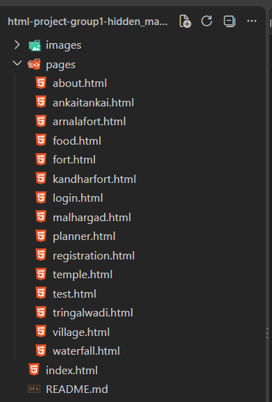

# 🏞️ Hidden Maharashtra – Explore the Hidden Beauty of Maharashtra 🌿

Discover beautiful hidden places, historic forts, peaceful villages, waterfalls, temples, and traditional foods of Maharashtra.

🌐 **Live Website:** [Hidden Maharashtra](https://hiddenmaharashtra.netlify.app/)

## 📖 About the Project

Hidden Maharashtra is a travel guide website created to explore the beautiful hidden destinations of Maharashtra. It helps travelers discover hidden places, historical forts, peaceful villages, waterfalls, hill stations, temples, and traditional Maharashtrian foods.

Our aim is to promote tourism and showcase the natural beauty, history, culture, and traditions of Maharashtra.

## ✨ Features

- 🏞️ Explore Hidden Places
- 🏰 Discover Historical Forts
- 🌊 Find Beautiful Waterfalls
- 🛕 Explore Temples and Peaceful Villages
- 🍛 Discover Famous Maharashtrian Foods
- 📍 Destination Information and Travel Tips
- 📩 About Page
- 🔐 Login and Registration Pages

## 🛠️ Technologies Used

- HTML5
- Git
- GitHub

## 🚀 Deployments

- [Netlify](https://hiddenmaharashtra.netlify.app/)

## 📸 Screenshots

### Home Page

## 📁 Folder Structure

## Contributors 🤝

---

### ❤️ Made with Love by Hidden Maharashtra Team

**Explore More. Travel Beyond. Discover Maharashtra!**
